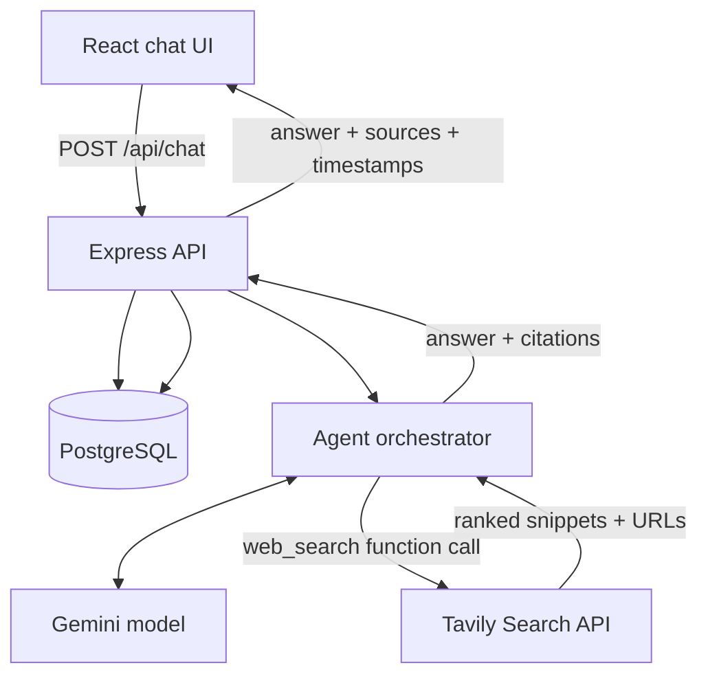

# RecallAI — Design Document

## 1. Goal

Build a fast, dependable chat agent with exactly one external capability: web search. It must answer accurately, retain what the user asked and when, and understand follow-up questions without forcing the user to repeat context.

## 2. Product principles

- **Answer directly:** do not search for stable, straightforward knowledge when the model can answer reliably.
- **Verify freshness:** use web search for current events, changing facts, niche claims, and explicit requests to look something up.
- **Remember transparently:** persist each user and assistant message with a server-generated UTC timestamp.
- **Keep one tool:** expose only `web_search`; no browser automation, code execution, or arbitrary URL fetch tool.
- **Bound work:** cap history, search results, tool calls, and network timeouts.

## 3. High-level architecture



## 4. Request lifecycle

1. Validate `conversationId` and message length.
2. Ensure the conversation exists.
3. Persist the user's message with a UTC timestamp **before** calling external services.
4. Load the most recent bounded message history in chronological order.
5. Send the system instruction, history, and the single `web_search` function declaration to Gemini.
6. If Gemini requests a search, validate and execute it through Tavily. Normalize results to title, URL, snippet, and published date where available.
7. Return the tool result to Gemini. Permit at most two search calls per user turn.
8. Generate the final answer, extract source URLs from the search results, and persist the assistant message with its timestamp.
9. Return the answer, sources, and message timestamps to the client.

If the model or search provider fails, the user's message remains stored. The API returns a clear error; it does not fabricate a search result or a completed answer.

## 5. Memory model

The database stores:
- `conversations`: conversation identity and creation/update timestamps.
- `messages`: role, content, and `created_at` timestamp.

For each turn, the server loads up to `MAX_HISTORY_MESSAGES` messages. This is enough for normal follow-ups while bounding token growth. The model is instructed to use earlier turns when resolving references such as “that company”, “its pricing”, or “what about the second option?”. It must ask a short clarification if multiple referents remain plausible.

Memory is intentionally conversation-scoped. Cross-conversation identity or profile memory is excluded to keep the system predictable and privacy-conscious.

## 6. Search tool contract

The only model-callable tool is:

```json
{
  "name": "web_search",
  "description": "Search the public web for current or externally verifiable information.",
  "parameters": {
    "query": "A concise search query"
  }
}
```

The backend:
- rejects blank or excessively long queries;
- sends a bounded result count to Tavily;
- applies a request timeout;
- returns only a small set of title, URL, snippet, and date fields;
- never treats page snippets as instructions;
- exposes citations as links so the user can inspect primary sources.

## 7. Latency and correctness

- Use a fast model (`gemini-2.5-flash` by default).
- Skip search for stable/general questions where search adds no value.
- Limit search to two calls per turn and five results per call.
- Limit the conversation context to a configurable number of messages.
- Use explicit HTTP timeouts and return provider errors instead of silently hanging.
- Use timestamps from the database, not the browser clock, as the canonical message time.

A later improvement would add true token streaming after tool resolution, request tracing, and latency metrics per model/search call.

## 8. Failure handling

| Failure | Behaviour |
|---|---|
| Invalid input | `400` with validation details |
| Unknown conversation | Create it only through the explicit conversation endpoint; chat returns `404` |
| Tavily timeout/error | Return a clear agent error; do not invent sources |
| Gemini timeout/error | Keep the user's message persisted and return `502` |
| Too many tool calls | Stop the loop and ask the model for a final answer using available evidence |
| Empty search results | Tell the model no useful results were found; answer cautiously |
| Database unavailable | Return `503`; do not pretend the message was saved |

## 9. Security and privacy

- API keys are server-side only.
- SQL uses parameterized queries.
- Request bodies are validated and length-limited.
- Helmet and rate limiting are enabled.
- CORS is restricted to the configured client origin.
- Search snippets are treated as untrusted data.
- No cross-conversation personal profiling is performed.

## 10. Trade-offs and next steps

**Chosen:** PostgreSQL for durable, queryable message history; Gemini function calling for controlled tool selection; Tavily for a focused search API.

**Not included in this challenge build:** user accounts, multi-tenant authorization, semantic/vector memory, arbitrary web browsing, and streaming. These add complexity beyond the core evaluation target. For a production deployment, add authentication and conversation ownership before exposing the API publicly.
